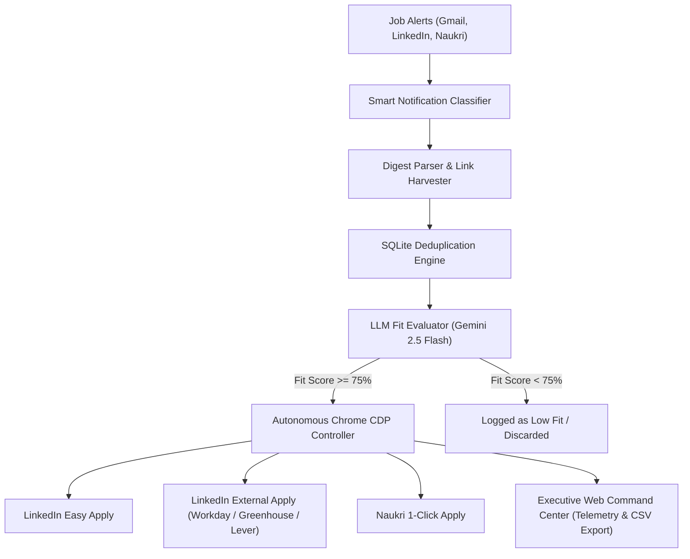

# ⚡ CareerPilot AI — Autonomous Career Agent & Application Engine

> **Tagline:** The autonomous AI agent that monitors your job alerts, evaluates fit against your resume, and automates applications on LinkedIn (Easy Apply & External `Apply ↗`), Naukri, and Enterprise ATS portals (Workday, Greenhouse, Lever).

---

## 🌟 Why CareerPilot AI?

Job seekers waste 15–20 hours every week reading repetitive alert emails, filling multi-page ATS forms, and guessing if they match the job description. Traditional bot clickers spam random jobs, get accounts restricted, and break down on external company career portals.

**CareerPilot AI changes the game:**
1. **Intelligent LLM Match Gate:** Powered by OpenRouter / Gemini 2.5 Flash, it scores every opportunity against your resume (0–100%), extracts missing vs. matched skills, and drafts custom tailored elevator pitches.
2. **Multi-Job Digest Harvester:** Connects directly to Gmail and extracts individual job cards from LinkedIn and Naukri daily digests.
3. **True External Apply (`Apply ↗`):** Automatically follows LinkedIn's `Apply on company website` redirects and autofills **Workday**, **Greenhouse**, **Lever**, and **SmartRecruiters** portals with candidate details and formatted PDF resumes.
4. **Zero-Ban Chrome CDP Architecture:** Attaches to your authenticated Google Chrome profile via Chrome DevTools Protocol (CDP port 9222). Zero bot detection, zero CAPTCHAs, and complete privacy (passwords never stored).
5. **Executive Web Command Center:** Dark-mode glassmorphic dashboard (`http://localhost:8000`) with live telemetry, 1-click auto-apply, dry-run review mode, and instant CSV export.

---

## 🏗️ Architecture



---

## ⚡ 1-Click Launch

Double-click `start_careerpilot.bat` or run:
```bat
start_careerpilot.bat
```
This automatically:
1. Opens Google Chrome with your authenticated sessions (Gmail, LinkedIn, Naukri).
2. Starts the **CareerPilot Web Command Center** at [http://localhost:8000](http://localhost:8000).

---

## 🛠️ CLI Commands

```powershell
# Activate virtual environment
.venv\Scripts\activate

# 1. Start Web Command Center
python main.py dashboard --port 8000

# 2. Run Pipeline in Review Mode (Dry-run scoring only)
python main.py run --dry-run --limit 10

# 3. Run Pipeline Live (Fills forms and stages for 1-click review)
python main.py run --limit 5

# 4. Run Pipeline with Auto-Submit (Direct submission on score >= 75%)
python main.py run --limit 5 --auto-submit

# 5. Instant Test Job Evaluation
python main.py match "Senior Test Automation Architect" --company "Enterprise AI Corp"

# 6. List Previous Applications & Scores
python main.py list-jobs --limit 20
```

---

## 📋 Features & Portals Supported

| Feature | Description | Status |
| :--- | :--- | :---: |
| **Gmail Alert Harvester** | Scans LinkedIn & Naukri alert notifications | ✅ Active |
| **Multi-Job Digest Parsing** | Extracts individual jobs from daily digest emails | ✅ Active |
| **Resume-Grounded LLM Scoring** | Deep matching against candidate skills & experience | ✅ Active |
| **LinkedIn Easy Apply** | In-app modal filling, contact pre-population, resume upload | ✅ Active |
| **LinkedIn External `Apply ↗`** | Follows redirects and lands on company career portals | ✅ Active |
| **Workday ATS Automation** | Clicks 'Autofill with Resume', attaches PDF, fills fields | ✅ Active |
| **Greenhouse & Lever ATS** | Auto-populates contact, links (GitHub/LinkedIn), and CV | ✅ Active |
| **Naukri 1-Click Apply** | Instant application on Indian job listings | ✅ Active |
| **Executive Web Dashboard** | Real-time tracking, metrics, and 1-click triggers | ✅ Active |
| **CSV Application Export** | Download full application audit trail | ✅ Active |

---

## 🔒 Privacy & Safety Guarantee

- **Local & Private:** SQLite database, credentials, and cookies remain exclusively on your local machine.
- **Review Mode by Default:** Applications are staged and reviewed before submission unless `--auto-submit` is passed.
- **CDP Re-use:** Uses your standard Chrome browser instance with established cookies.
